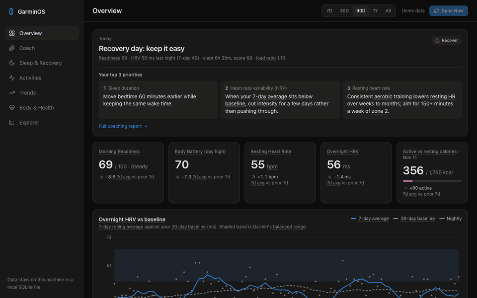
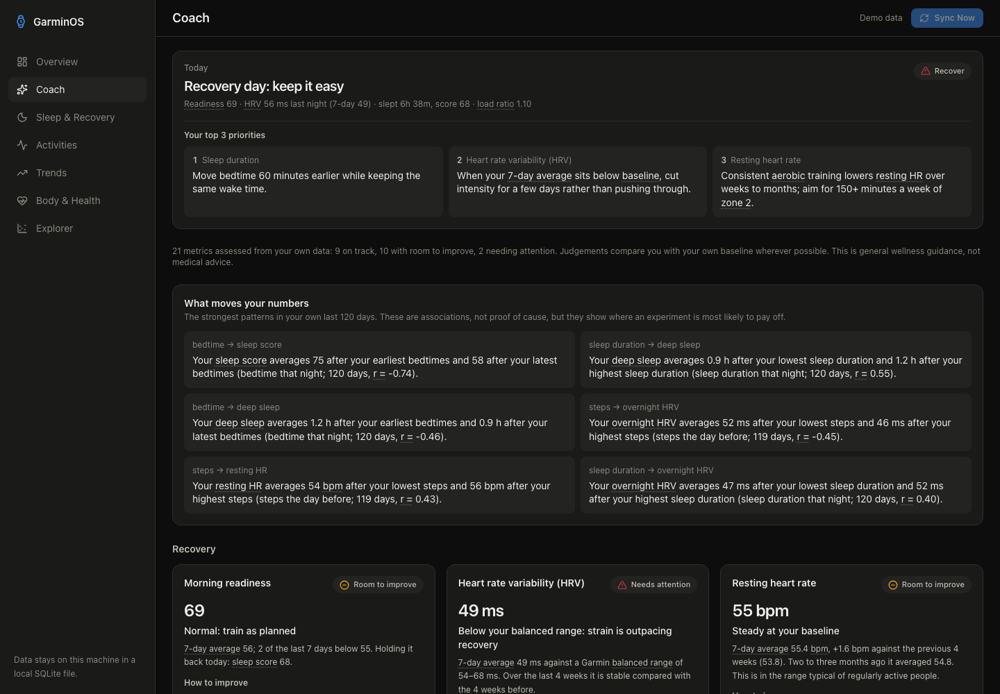
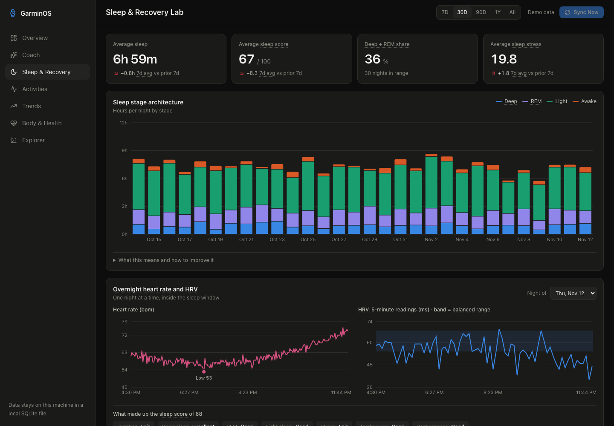
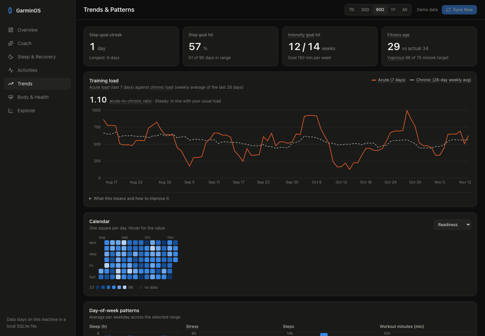

# GarminOS

A local, dark-mode health and fitness dashboard on top of the **Garmin Connect Personal API**.
Data is synced into a SQLite file on this machine, so pages load instantly and history is kept even
if Garmin later drops it.

[](https://github.com/PranshuGhori/GarminOS/actions/workflows/ci.yml)



| Coach | Sleep | Trends |
|---|---|---|
|  |  |  |

Everything shown is generated demo data.

> **Unofficial project.** Not affiliated with or endorsed by Garmin. Garmin, Garmin Connect and Body Battery are
> trademarks of Garmin Ltd. You use your own Personal API key to read your own data, under the terms you accepted
> when you created that key; the Personal API is intended for individual access, not for apps serving other people.
> Everything here is general wellness information, not medical advice.

## Run it

Requires Node.js 22 or newer. Works on macOS, Linux and Windows.

```bash
git clone https://github.com/PranshuGhori/GarminOS.git && cd GarminOS
npm install
cp .env.example .env     # Windows: copy .env.example .env   — then paste your key into .env
npm run dev              # http://localhost:3000, then press "Sync Now"
```

Create the key at <https://connect.garmin.com/app/settings/personalApiToken>. Keys expire after 30–365 days
(you choose); when sync reports that Garmin rejected the key, create a new one and replace it in `.env`.

The database is created automatically on first start. The first sync reaches back up to two years and takes a
few minutes; if it is interrupted it resumes from where it stopped on the next sync. To watch progress, run
`npm run sync` in a terminal instead of using the button.

### Or with Docker

```bash
git clone https://github.com/PranshuGhori/GarminOS.git && cd GarminOS
cp .env.example .env     # paste your key
docker compose up -d     # http://localhost:3000
```

Your data is kept in the `garminos-data` volume and survives upgrades (`git pull && docker compose up -d --build`).
The port is published on `127.0.0.1` only. To try it with demo data and no key: `GARMIN_MOCK=1 docker compose up -d`.

### Demo data (no key needed)

```bash
npm run seed:mock      # writes 200 days of generated data to prisma/mock.db
npm run dev:mock       # http://localhost:3001, sync disabled
```

Real and demo data live in separate database files and never mix.

## Privacy and security

- Your key, token and all health data stay on your machine: `.env` and `prisma/*.db`, both gitignored. The only
  outbound connections are to Garmin's API.
- The dashboard has no login, so it listens on `127.0.0.1` only and refuses requests addressed to any other
  host name or coming from other websites. Other devices on your network cannot open it.
- To deliberately open it to your home network (for example to view on a phone), use `npm run dev:lan`. Anyone on
  that network can then read your data. Do not expose it to the internet.
- The 24-hour bearer token is cached unencrypted in the local database file.

## Pages

| Page | What it answers |
|---|---|
| Overview | How am I today? Daily briefing, readiness, HRV vs baseline, day detail, stress breakdown |
| Coach | What does each metric mean, how am I doing against my own baseline, and what should I change? |
| Sleep & Recovery | Stages, overnight HR/HRV, sleep need, consistency, score components |
| Activities | Polarized training, best efforts, feed, per-activity detail (route, dynamics, splits, sets) |
| Trends | Training load ratio, calendar, weekday patterns, goals, weekly summary |
| Body & Health | Weight, body fat, VO2 max, SpO2, respiration, hydration, cycle (each shown when your account has it) |
| Explorer | Any metric against any other, same day or lagged |

The Coach page is driven by two files: `src/lib/knowledge.ts` (what each of 21 metrics means, how to read it,
what moves it) and `src/lib/coach.ts` (rules that score your data, pick personalised next steps, find the
strongest patterns in your own history, and write the daily briefing). Thresholds are documented inline and
compare you with your own baseline wherever a personal baseline is more meaningful than a population norm.
It is general wellness guidance, not medical advice.

Units follow your Garmin profile (metric or statute); set `UNITS=metric|imperial` in `.env` to override.

## Syncing

| Trigger | What it does |
|---|---|
| **Sync Now** button | Incremental: re-fetches from 3 days before the last synced day, new activities, up to 40 new .FIT files |
| Background | While the server runs: checks every 15 min, syncs if the last success is older than `SYNC_INTERVAL_HOURS` (default 6, `0` disables) |
| `npm run sync` | Same as the button, with progress. `-- --days 90` forces a re-fetch window, `-- --fit 200` sets the .FIT cap |

First run backfills up to `SYNC_BACKFILL_DAYS` (default 730), stops early after two empty 28-day windows, and resumes if interrupted.

Requests go through one queue: ≥350 ms apart (`GARMIN_MIN_GAP_MS`), with exponential backoff on 429/5xx
(honouring `Retry-After`) and one automatic token re-exchange on 401. If Garmin answers 429 the spacing doubles
(up to 5 s) for the rest of the run and relaxes gradually. Garmin does not publish rate limits.
The 24-hour bearer token is cached in the `AuthToken` table and refreshed 5 minutes before expiry.

## Layout

```
prisma/schema.prisma          DailyMetric, Sleep, NightSeries, Activity, ActivityLap, ActivityStream, BodyComposition, AuthToken, SyncLog
scripts/sync.ts               CLI sync
scripts/seed-mock.ts          demo data generator
src/instrumentation.ts        starts the background scheduler
src/lib/garmin/client.ts      key → token exchange, token cache, rate-limited retrying fetch
src/lib/garmin/sync.ts        ingestion pipeline (daily, HRV, sleep, weight, activities, .FIT, overnight curves)
src/lib/garmin/fit.ts         unzip + parse .FIT → laps and a downsampled stream
src/lib/metrics.ts            joins days, rolling HRV, readiness score, KPI deltas
src/lib/garmin/map.ts         Garmin JSON → column mappers (shared by sync and `npm run remap`)
scripts/remap.ts              re-derive columns from stored raw JSON, no Garmin calls
src/app/                      pages: / (Overview), /sleep, /activities, /trends, /explorer, and /api/{sync,night,day,activity/[id]}
src/components/               charts and UI
```

## How the numbers are computed

- **Morning Readiness** = 40% HRV + 35% Garmin sleep score + 25% resting HR. HRV and RHR are scored against
  your own trailing 30 days (60 = at your norm, ±20 per standard deviation, lower RHR is better).
  It is this app's own score, not a Garmin metric.
- **Aerobic efficiency** = normalised/average power ÷ average HR for power sports, otherwise metres per minute ÷ average HR.
- **Training load ratio** = load of the last 7 days ÷ weekly average of the last 28 days. Around 0.8–1.3 is in line with what you are used to; above 1.5 is a fast ramp-up.
- **Polarized chart** = heart-rate zone time per week: low (Z1–2), moderate (Z3), high (Z4–5).

## What the Personal API does not provide

- No intraday stress series, so the overnight panel shows heart rate and 5-minute HRV instead of a stress curve.
- VO2 max is not in the activity list; it is filled in only when the .FIT file carries it.
- Workout feel/RPE and food logs are empty unless you log them in Garmin Connect, so they are not shown.
- Strength sets come from Garmin's per-exercise summary; exercises the watch could not identify show as "Unlabelled".
- SpO2, weight, hydration and cycle data appear only if your device/account records them.

Open a specific activity directly with `/activities?open=<activityId>`. The route trace is drawn without map tiles, so no location data leaves this machine.

## Development

```bash
npm test            # mapper, unit, glossary and coach tests (uses a throwaway prisma/test.db)
npm run typecheck
npm run remap       # after editing src/lib/garmin/map.ts: re-derive columns from stored raw JSON, no Garmin calls
```

### Known gaps: help wanted

This was developed against one account (a running/strength watch with HRV, US units). These paths are covered by
tests with synthetic data but have not been run against a real account, and field names may need adjusting in
`src/lib/garmin/map.ts`:

- SpO2 (`pulseOx` field name is a best guess), weight and body composition, hydration
- Menstrual cycle summary (read defensively on the Body page)
- VO2 max, cycling with a power meter, swimming
- Accounts with many years of history

If something shows as missing for you, open an issue with the field names from the relevant `raw` column
(remove anything personal first).

## License

MIT. See [LICENSE](LICENSE).
